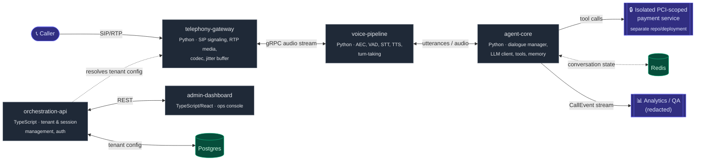

# VoiceAgent Platform

[](.github/workflows/ci.yml)
[](LICENSE)
[](services/agent-core/pyproject.toml)
[](services/orchestration-api/package.json)

A white-label, multi-tenant **AI voice agent platform** for regulated, latency-sensitive environments — banking IVR replacement and contact centers — designed for sub-500ms speech-in-to-speech-out latency, on-premise/air-gapped deployment, and a hard service-boundary isolation around payment capture.

This is a from-scratch systems-design exercise: a microservice voice pipeline (SIP/RTP → VAD → STT → LLM dialogue → TTS) built the way a production telephony-AI platform actually has to work — codec correctness, echo cancellation, turn-taking, LLM failover, and compliance, not just a happy-path demo.

## Why this repo exists

Most "AI voice agent" demos wire an LLM to a microphone and call it done. This project goes further on purpose, into the parts that only show up once you've run one of these in front of real callers:

| Concern | What's actually implemented |
|---|---|
| **Telephony audio is G.711 @ 8kHz, not 16kHz PCM** | A from-scratch G.711 μ-law/A-law codec (validated bit-for-bit against Python's reference `audioop` behavior), resampling, and real RTP packetization — [`codec.py`](services/telephony-gateway/src/telephony_gateway/codec.py) |
| **Networks drop and reorder packets** | A jitter buffer with packet-loss concealment — [`jitter_buffer.py`](services/telephony-gateway/src/telephony_gateway/jitter_buffer.py) |
| **The agent can hear itself** | An adaptive (NLMS) echo canceller runs before VAD ever sees a frame, so barge-in detection doesn't trigger on the agent's own voice — [`aec.py`](services/voice-pipeline/src/voice_pipeline/aec.py) |
| **Silence ≠ "done talking"** | Two-stage endpointing: VAD silence is tentative, extended once for a mid-thought pause instead of interrupting the caller — [`endpointing.py`](services/voice-pipeline/src/voice_pipeline/endpointing.py) |
| **Barge-in has to actually cancel generation** | A cancellation token stops in-flight LLM/TTS output immediately, with a "false interruption" resume path for noise/false positives — [`turn_manager.py`](services/voice-pipeline/src/voice_pipeline/turn_manager.py) |
| **LLM providers go down mid-call** | Circuit breaker + fallback chain + a "thinking filler" hook instead of dead air — [`llm_client.py`](services/agent-core/src/agent_core/llm_client.py) |
| **Calls run long** | Redis-backed conversation state with token-budget summarization, so context doesn't blow past the latency budget on a 10-minute call — [`memory.py`](services/agent-core/src/agent_core/memory.py) |
| **Payments can't double-charge** | Idempotency-keyed retries on the payment tool call — [`payment_capture.py`](services/agent-core/src/agent_core/tools/payment_capture.py) |
| **Regulated calls need disclosure** | A compliance-gated call-opening disclosure + PII redaction on analytics events — [`compliance.py`](services/agent-core/src/agent_core/compliance.py), [`redaction.py`](services/agent-core/src/agent_core/redaction.py) |
| **"It works on my machine" ≠ production** | k8s resource limits/probes/PodDisruptionBudgets, a documented SIP/RTP networking model, and a CI job that actually measures latency against budget instead of `echo "placeholder"` |

Every decision above is written up as an [ADR](docs/adr/) with the reasoning, trade-offs, and what's explicitly out of scope — and every piece of logic has a passing test. See [`docs/demo-walkthrough.md`](docs/demo-walkthrough.md) for a step-by-step trace of one call mapping each scenario to the exact code path and test that covers it.

## Architecture



Full call-flow narrative and the latency budget per stage: [`ARCHITECTURE.md`](ARCHITECTURE.md).

## Repository layout

This is a monorepo. Each service is independently deployable and independently testable.

```
services/
  telephony-gateway/     Python. SIP/RTP, codec conversion, jitter buffer, DTMF (Asterisk ARI / FreeSWITCH ESL)
  voice-pipeline/        Python. Echo cancellation, VAD, streaming STT/TTS, endpointing, turn-taking
  agent-core/            Python. Dialogue management, resilient LLM orchestration, tool calling, memory, compliance
  orchestration-api/     TypeScript. Session orchestration, tenant management, auth, external REST API
  admin-dashboard/       TypeScript/React. Internal ops console

shared/
  proto/                 gRPC/protobuf contracts shared across services
  schemas/               JSON Schemas for events (call lifecycle, transcripts, tool calls)
  types-ts/              Shared TypeScript types mirroring proto/schemas

infra/                   Docker, docker-compose, and Kubernetes manifests
compliance/pci/          PCI DSS scope notes and the isolation design for payment capture
docs/adr/                Architecture Decision Records — the "why", not just the "what"
scripts/                 Local dev setup and operational scripts
```

## Why Python and TypeScript

- Python owns everything on the hot voice path and anything touching model inference: telephony media handling, STT/TTS, VAD, AEC, and the agent's dialogue/LLM orchestration — where the audio/ML ecosystem is strongest.
- TypeScript owns the orchestration API, tenant/session management, and the admin dashboard, where a strongly typed request/response surface matters more than raw audio throughput.
- The two sides talk over gRPC (contracts in `shared/proto`) so the language boundary doesn't become a source of drift.

## Getting started (local dev)

```bash
cp .env.example .env
make setup
make up
```

`make up` brings up Asterisk, Redis, Postgres, and every service in docker-compose. See each service's own README for service-specific instructions.

```bash
make test                          # every service's test suite
python scripts/latency_benchmark.py  # the latency-budget regression check that gates CI
```

## Status

This is a solo systems-design project, not a production deployment — there's no live SIP trunk or model API key behind it. What's real: the architecture, the service boundaries, and every piece of logic named in the table above, each backed by a passing test. What's intentionally left as a documented interface boundary rather than a full implementation (a specific hosted STT/TTS provider, a native WebRTC AEC binary, actual model weights) is called out explicitly in the relevant ADR, not quietly stubbed out.

See [`docs/adr/`](docs/adr/) for the architectural decisions behind the stack choices, [`ARCHITECTURE.md`](ARCHITECTURE.md) for the system-level call flow, and [`docs/demo-walkthrough.md`](docs/demo-walkthrough.md) to see it traced end to end.

## License

MIT — see [LICENSE](LICENSE).
